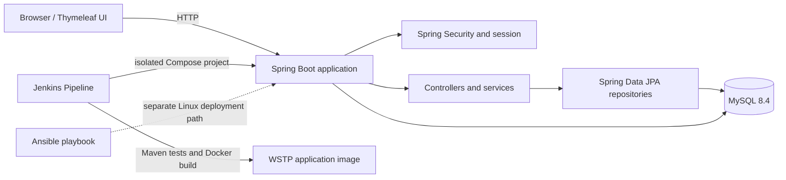

# Jenkins Deployment for a Women Skill Training Portal (WSTP)

## 1. Project overview

WSTP is a Spring Boot web application for browsing skills training programs, registering learner or trainer accounts, signing in, and enrolling a learner in a program. This repository also contains a Jenkins pipeline, Docker image and Compose configuration, and an Ansible playbook for a separate Linux deployment path.

> **Project status:** This README describes the implementation in this repository. Jenkins Build #20 was reported as successful by the project owner; its Jenkins console log is not stored here and was not independently inspected for this update. A real deployment to an Ansible-managed Linux host has not been verified.

## 2. Problem statement and objectives

Women seeking practical digital, business, finance, communication, and other skills need a simple way to discover training options and track program enrollment. WSTP provides a web interface for exploring those programs and a learner account flow for registration, authentication, and enrollment.

The DevOps objectives are to:

- Build and test the Java application through Maven.
- Run browser-level checks for important learner workflows.
- Build a repeatable Java 21 container image and run the app with MySQL through Docker Compose.
- Use Jenkins to build, publish JUnit results, build an image, and verify application startup.
- Provide an Ansible playbook for preparing and deploying to a supported Linux host.

## 3. Implemented features

### Implemented

- Home page and Thymeleaf pages for registration, sign-in, program browsing, program details, and the learner dashboard.
- Public registration for `LEARNER` and `TRAINER` accounts. The server defaults an omitted role to `LEARNER` and rejects other roles; passwords are stored using BCrypt.
- JSON login at `POST /api/auth/login`. Successful authentication is saved in the HTTP session, and the browser redirects to `/dashboard`.
- Program listing, category filtering, and active program details.
- Authenticated learner enrollment in active programs, duplicate-enrollment checks, and per-user enrollment data.
- Dashboard enrollment cards and counts loaded from `GET /api/enrollments/my`.
- MySQL persistence in Compose with a named data volume and a MySQL health check.
- Maven context, registration, login/access, and Selenium browser tests.
- Jenkins Maven verification, JUnit report publication, image build, isolated Compose project deployment, and bounded startup-log polling.
- An Ansible playbook for supported Debian/Ubuntu deployments; see its validation limitations below.

### Partially implemented

- The dashboard has static sample content for learning hours, progress, streaks, and recent activity. Those values are not all derived from persisted learner data.
- The account model includes `LEARNER`, `TRAINER`, and `ADMIN`, but there is no separate trainer/admin portal or role-specific authorization policy. Public registration cannot create an admin account.
- Selenium and integration tests cover core flows, but they do not constitute exhaustive security, performance, accessibility, or compatibility testing.

## 4. Technology stack

| Area | Technology |
|---|---|
| Language/runtime | Java 21 |
| Application framework | Spring Boot 4.1.1, Spring MVC, Spring Data JPA |
| Views | Thymeleaf and browser-side JavaScript |
| Security | Spring Security, BCrypt, HTTP session |
| Production database | MySQL 8.4 |
| Test database | H2 |
| Build | Maven 3.9.16 through the Maven Wrapper |
| Browser tests | Selenium WebDriver with Chrome/ChromeDriver |
| Packaging/runtime | Multi-stage Docker build, Eclipse Temurin 21 |
| Local orchestration | Docker Compose |
| CI/local deployment | Jenkins Pipeline on a configured Windows agent |
| Linux deployment option | Ansible Core 2.15 or newer |

## 5. System architecture and application workflow



For local Compose use, the browser connects to the app on `127.0.0.1:8081`. Compose starts MySQL, waits for its health check, and then starts the app. The database is reachable by the app on the Compose network and is not published on a host port by the supplied Compose file.

Registration posts JSON to `POST /api/users/register`. Login posts JSON to `POST /api/auth/login`; the server authenticates through Spring Security and saves the security context in the HTTP session. The login page uses same-origin credentials and redirects to the authenticated `/dashboard` page. The dashboard requests the signed-in learner's enrollments. Program enrollment posts to `POST /api/enrollments/{programId}` using the browser's session.

| Route | Purpose | Access |
|---|---|---|
| `GET /` | Home page | Public |
| `GET /programs` and `GET /programs/{id}` | Catalog and program details | Public |
| `GET /register`, `POST /api/users/register` | Registration page and API | Public; API allows learner/trainer only |
| `GET /login`, `POST /api/auth/login` | Login page and JSON authentication API | Public |
| `GET /dashboard` | Learner dashboard | Authenticated session required |
| `POST /api/enrollments/{programId}` | Enroll current user | Authenticated session required |
| `GET /api/enrollments/my` | Current user's enrollments | Authenticated session required |

## 6. Repository structure

```text
.
├── ansible/
│   ├── deploy.yml                 # Linux host preparation and Compose deployment
│   ├── README.md                  # Ansible prerequisites and run instructions
│   └── inventory/hosts.example.yml
├── src/
│   ├── main/java/com/wstp/portal/ # Controllers, entities, repositories, services, security
│   ├── main/resources/            # Spring configuration, SQL seed data, Thymeleaf pages
│   └── test/                      # H2 configuration, integration and Selenium tests
├── .env.example                  # Safe local environment template
├── Dockerfile                    # Multi-stage Java 21 image build
├── compose.yaml                  # App + MySQL services and named MySQL volume
├── Jenkinsfile                   # Maven CI and isolated local Compose deployment
├── mvnw, mvnw.cmd                # Maven Wrapper launchers
└── pom.xml                       # Dependencies and build configuration
```

## 7. Prerequisites and local setup

### Prerequisites

- Git and Java 21.
- Docker Desktop with a working Docker engine and Docker Compose for the Compose workflow.
- Chrome and a compatible ChromeDriver for Selenium browser tests. Set `CHROMEDRIVER_PATH` when the driver is not discoverable automatically.
- For direct host execution instead of Compose, a MySQL server reachable at `localhost:3306` with the configured database and user.

### Get the project ready

From the repository root, create a local environment file from the template and replace the placeholder values with local-only secrets:

```powershell
Copy-Item .env.example .env
notepad .env
```

`.env` is ignored by Git. Do not commit it or paste real credentials into documentation, source files, screenshots, or command history. The checked-in `.env.example` contains placeholders and is not a usable secret configuration.

### Recommended: run with Docker Compose

The Compose file requires `MYSQL_PASSWORD` and `MYSQL_ROOT_PASSWORD` to be set. The commands below use a separate project and host port `8082` so they do not replace the existing `wstp-validation-codex` stack on the default port:

```powershell
$env:APP_PORT = '8082'
docker compose -p wstp-local config --quiet
docker compose -p wstp-local up --build --detach
docker compose -p wstp-local ps
```

Open `http://127.0.0.1:8082/`, then use the Programs, Register, Sign In, and Dashboard pages. Use a newly registered account for enrollment checks. Keep `APP_PORT` set for subsequent Compose commands in that shell. If you deliberately intend to inspect or update another stack, replace the project name consistently; Compose project names scope its containers, networks, and named volumes.

Useful read-only inspection commands:

```powershell
docker compose -p wstp-local ps
docker compose -p wstp-local logs --tail 100 app db
```

To stop the existing stack without removing its containers or data:

```powershell
docker compose -p wstp-local stop
```

Compose stores database data in its project-scoped `mysql_data` named volume. Do not use `docker compose down --volumes` or `docker volume prune` when that data must be retained. A plain `docker compose down` removes containers and the network but leaves named volumes unless the volume-removal option is supplied.

## 8. Environment variables and safe configuration

| Variable | Used by | Purpose |
|---|---|---|
| `DB_PASSWORD` | Direct Spring Boot host run | Password for the configured local MySQL user (`root` in the current properties file). |
| `MYSQL_DATABASE` | Compose | MySQL database name; defaults to `women_skill_training_portal`. |
| `MYSQL_USER` | Compose | MySQL application user; defaults to `wstp_app`. |
| `MYSQL_PASSWORD` | Compose | Required password for the MySQL application user. |
| `MYSQL_ROOT_PASSWORD` | Compose | Required MySQL root password. |
| `APP_IMAGE` | Compose | App image tag; defaults to `women-skill-training-portal:local`. |
| `APP_PORT` | Compose | Host-side app port; defaults to `8081`. |
| `APP_BIND_ADDRESS` | Compose | Host bind address; defaults to `127.0.0.1`. |

Compose reads these values from the process environment or `.env`. The Jenkins stage supplies build-specific CI database values and a unique Compose project through `withEnv`; do not copy those CI values into a local `.env`. Ansible prompts privately for the application and MySQL root passwords and supplies them to the remote Compose invocation. Docker administrators can inspect container environment values, so this is a course deployment arrangement rather than a production secrets system.

## 9. Database setup and persistence

- `compose.yaml` runs MySQL 8.4 and stores `/var/lib/mysql` in the named `mysql_data` volume. Compose scopes the volume to its project name.
- The app waits for the database health check before starting. The check uses `mysqladmin ping` inside the MySQL container.
- The app's datasource points to the Compose service name `db` and receives database connection values from Compose environment variables.
- JPA uses `spring.jpa.hibernate.ddl-auto=update`; the SQL initializer is enabled and `src/main/resources/data.sql` inserts sample programs only when matching rows are absent.
- Tests use separate in-memory H2 databases and disable SQL seed initialization where configured. They do not use the Compose MySQL volume.
- No Flyway or Liquibase migration history is present. Schema evolution currently relies on Hibernate's `update` setting.

Do not delete the named database volume to troubleshoot application code. Before any intentional database reset, make and verify a backup and obtain the data owner's approval.

## 10. Run the Spring Boot application

For direct host execution, configure a reachable MySQL instance and set `DB_PASSWORD` as described in [Environment variables and safe configuration](#8-environment-variables-and-safe-configuration). Then start the application:

```powershell
$env:DB_PASSWORD = '<your local MySQL password>'
.\mvnw.cmd spring-boot:run
```
## 11. Test strategy and verified results

Run the full Maven lifecycle, including tests and packaging:

```powershell
.\mvnw.cmd -B clean verify
```

Run only the browser tests:

```powershell
.\mvnw.cmd -B -Dtest=PortalBrowserTests test
```

Run the focused login/dashboard and registration integration tests:

```powershell
.\mvnw.cmd -B -Dtest=LoginDashboardTests,UserRegistrationTests test
```

The Selenium tests start the app on a random port and use H2. A compatible Chrome/ChromeDriver installation is required. `CHROMEDRIVER_PATH` may point to the driver executable. Failed browser tests attempt to save screenshots under `target/selenium-screenshots/`; those are diagnostic artifacts, not pre-created demo evidence.

### Test results verified for this repository state

On **2026-10-19**, `mvn -B clean verify` completed with **11 tests, 0 failures, 0 errors, and 0 skipped**:

| Test class | Tests | Result |
|---|---:|---|
| `LoginDashboardTests` | 2 | Passed |
| `UserRegistrationTests` | 3 | Passed |
| `PortalBrowserTests` | 5 | Passed |
| `WomenSkillTrainingPortalApplicationTests` | 1 | Passed |

This is a local Maven result, not evidence of a newer Jenkins run. The command was executed using the cached Maven 3.9.16 distribution with Java 21 because `mvn` was not on this environment's `PATH`; it completed the same `clean verify` Maven lifecycle used by the pipeline.

## 12. Docker image and Compose workflow

The Dockerfile uses Maven with Eclipse Temurin 21 to package the application, then copies the JAR into an Eclipse Temurin 21 JRE image. The runtime process uses UID/GID `10001` and exposes port `8081` inside the container.

The Compose application service can build the image locally:

```powershell
$env:APP_PORT = '8082'
docker compose -p wstp-local build app
docker compose -p wstp-local up --detach
docker compose -p wstp-local ps
```

For a clean validation that does not connect to the Docker engine or start containers, render the Compose configuration:

```powershell
docker compose -p wstp-local config --quiet
```

The stack publishes only the app port on the configured bind address; MySQL has no host-published port. The Jenkins pipeline uses per-build project names and database names rather than this local project. The pipeline currently has no cleanup step for those CI projects, so CI containers and project-scoped volumes may remain after a build.

## 13. Jenkins pipeline

The root `Jenkinsfile` defines these stages:

1. **Checkout SCM** — checks out the configured source revision.
2. **Verify Java 21** — checks `JAVA_HOME` and prints the Java version.
3. **Build and test** — validates Maven and ChromeDriver configuration, then runs `mvn -B clean verify`.
4. **Docker image and local deployment** — checks the Docker CLI/engine and explicit Compose executable, builds a build-number-tagged image, starts a separate Compose project, and checks app startup.

The deployment stage sets `COMPOSE_PROJECT_NAME` to `wstp-jenkins-${BUILD_NUMBER}` and uses a CI-specific database name. It checks the app logs for the Spring Boot `Started WomenSkillTrainingPortalApplication` marker for up to 30 polls at 2-second intervals. If the marker is not found, it prints Compose status and app/database logs and fails. This is a bounded startup-log check, not an HTTP health endpoint check. JUnit XML reports are published in the `post { always { ... } }` section; missing reports fail publication because `allowEmptyResults` is false.

To inspect a build, open the Jenkins job's build page and review **Stage View**, **Console Output**, and the **Test Result** link. Confirm that the Docker deployment stage actually ran; a green Maven stage alone does not prove deployment.

**Host-specific configuration:** the current Jenkinsfile contains absolute Windows paths for Docker CLI, Compose executable, and ChromeDriver, and requires configured `JAVA_HOME`, `MAVEN_HOME`, and `MAVEN_OPTS`. These paths match the current Jenkins host setup and must be reviewed when moving Jenkins or changing its service account. Jenkins Build #20 was previously reported as successful by the project owner. Its logs are not checked into this repository; no newer Jenkins build is claimed here.

## 14. Ansible deployment

The Ansible playbook is an optional Linux deployment path; it is not invoked by the Jenkins pipeline.

### Prerequisites and configuration

- Ansible Core 2.15 or newer on a Linux or WSL control node.
- SSH access and sudo privileges on an authorized Debian or Ubuntu host.
- Internet access on the target for packages, Docker images, and Maven build dependencies.
- A supported target architecture: `x86_64`, `aarch64`, or `armv7l`.
- No conflicting legacy Docker packages if Docker Engine is absent; the playbook stops instead of removing them.

Copy the example inventory to the ignored local inventory and replace the reserved placeholder hostname with an authorized target:

```sh
cp ansible/inventory/hosts.example.yml ansible/inventory/hosts.yml
```

Set the SSH host/user and review `deployment_root`, `compose_project_name`, `app_port`, `app_bind_address`, image tag, database name, and database user in `ansible/inventory/hosts.yml`. The example binds the app to `127.0.0.1`; MySQL is not published on a host port. The real inventory is ignored by Git.

### Validate and run

Syntax check using only the example inventory:

```sh
ansible-playbook --syntax-check -i ansible/inventory/hosts.example.yml ansible/deploy.yml
```

After configuring the real inventory, check mode and then an authorized deployment are:

```sh
ansible-playbook --check --diff -i ansible/inventory/hosts.yml ansible/deploy.yml --ask-become-pass
ansible-playbook -i ansible/inventory/hosts.yml ansible/deploy.yml --ask-become-pass
```

The playbook prompts privately for the MySQL application-user password and the MySQL root password. It installs Docker Engine/Compose when required, copies the build inputs, builds an image on the target, starts a Compose project with a wait timeout (including the MySQL health check), and then retries an HTTP request until the configured app port returns 200. It does not publish an image to a registry. Check mode does not execute the Compose deployment or HTTP health request.

An earlier Ansible syntax check was reported as passing. Ansible CLI was not available in the current documentation environment, so that check was not repeated here. The repository's Ansible documentation states that the playbook has **not** been run against a real deployment host. Therefore no remote deployment, provisioning result, or target health result is claimed. Review network exposure and inventory before running it.

## 15. Known limitations and future improvements

- Enable and correctly integrate CSRF protection for state-changing browser requests before production use; the current `SecurityConfig` disables CSRF globally.
- Add role-specific authorization and trainer/admin workflows if those roles need privileged capabilities. The existing `ADMIN` enum value alone does not provide an admin portal.
- Replace remaining dashboard sample progress/activity values with persisted learner data and implement the currently marked “coming soon” features.
- Implement a real logout operation that invalidates the authenticated HTTP session; the current dashboard logout control only navigates to `/login`.
- Replace hard-coded Jenkins host paths with managed Jenkins tools or configurable agent-level settings, and record build evidence in the project handoff.
- Consider an HTTP readiness endpoint and a tested CI cleanup policy. CI Compose projects currently have unique names but no pipeline cleanup stage.
- Use a schema migration tool for controlled database evolution; the current setup uses Hibernate `update`.
- Run and document Ansible on an authorized Linux target before describing that deployment as verified.
- Add operational monitoring, backups, secrets management, and production hardening before any public or production deployment.

No registry push, production deployment, rollback process, monitoring stack, performance benchmark, or completed course certificate is implemented or verified by the checked-in artifacts.

## 16. Screenshots and demo evidence checklist

No screenshots or demo recordings are included in this repository. Capture authentic evidence from the actual system and redact personal data, session identifiers, secrets, and private host details before sharing.

- [ ] Home page and program catalog.
- [ ] Program category filter and a program details page.
- [ ] Registration validation and a successful learner or trainer registration.
- [ ] Successful sign-in ending at the dashboard, plus an anonymous dashboard redirect to sign-in.
- [ ] Successful enrollment and the enrolled program shown on the learner dashboard.
- [ ] Jenkins stage view, console output, and JUnit report for the exact build being presented.
- [ ] Docker Compose app/database status and application response for the exact local stack being presented.
- [ ] Ansible syntax-check output; if performed later, separate real-host run and health-check output.
- [ ] Git branch and commit corresponding to the demonstrated source.

Do not label a placeholder, generated mockup, or test screenshot as a real deployment or result. Store future approved evidence in a clearly named project evidence directory and identify its date/build/commit.

## 17. Provisional Week 1–15 rubric mapping

No official weekly rubric or schedule is included in the repository. This is a **provisional mapping of visible project milestones**, not a claim that the faculty rubric uses these exact week topics. Reconcile it against the official assignment before submission.

| Week | Provisional milestone | Status | Repository evidence / remaining evidence |
|---:|---|---|---|
| 1 | Project setup and objectives | **DONE** | Spring Boot Maven application and project overview/objectives in this README. |
| 2 | Requirements and architecture | **PARTIAL** | Architecture is described here; no official requirements, user stories, or faculty acceptance checklist is tracked. |
| 3 | Domain model and persistence | **DONE** | JPA user, role, program, and enrollment entities; repositories; MySQL/H2 configuration. |
| 4 | Web interface | **PARTIAL** | Home, login, registration, programs, details, and dashboard templates exist; dashboard includes sample content. |
| 5 | Registration and authentication | **PARTIAL** | BCrypt, learner/trainer registration allowlist, session login and authentication tests exist; CSRF is disabled and roles do not have a complete role-specific policy. |
| 6 | Program catalog | **DONE** | Active program listing, category filtering, detail page, and seed data are implemented. |
| 7 | Enrollment workflow | **DONE** | Authenticated enrollment, duplicate check, active-program check, and enrollment tests are implemented. |
| 8 | Learner dashboard | **PARTIAL** | Enrollment data/counts are loaded from the API; other visible progress and activity values remain sample/static. |
| 9 | Automated testing | **PARTIAL** | Current local `clean verify` passed 11 tests; coverage is focused on core flows and is not exhaustive. |
| 10 | Version control | **DONE** | Git history and the `feature/program-enrollment` branch are present. |
| 11 | Jenkins CI | **PARTIAL** | Jenkinsfile includes Maven/JUnit stages; Build #20 was owner-reported successful, but Jenkins logs/evidence are not stored here and host paths are fixed. |
| 12 | Docker image and Compose stack | **DONE** | Multi-stage Dockerfile, MySQL/app Compose services, health check, and named volume are implemented; a current deployment was not rerun for this documentation change. |
| 13 | Jenkins local Compose deployment | **PARTIAL** | Isolated build-tagged image/project and bounded startup-log check are implemented; Build #20 is reported successful, but no build log is attached and cleanup is absent. |
| 14 | Ansible Linux deployment | **PARTIAL** | Playbook and example inventory exist; syntax check was previously reported passed, but no real target-host run has been verified. |
| 15 | Release evidence and operations | **TODO** | No verified remote deployment, registry publication, rollback, monitoring, or screenshot/demo evidence is included. |

### Items that require real-world evidence

- A Jenkins build URL or exported console/stage/test results for the exact submitted commit. Build #20 is a prior owner report, not a checked-in artifact.
- A real Ansible run against an authorized Debian/Ubuntu host, including the resulting service state and HTTP check, before claiming remote deployment.
- Screenshots or a recording captured from the actual running application and identified with the build/commit being demonstrated.
- Any requested performance, security assessment, production availability, backup/restore, or rollback claims; none has been verified by this repository audit.
